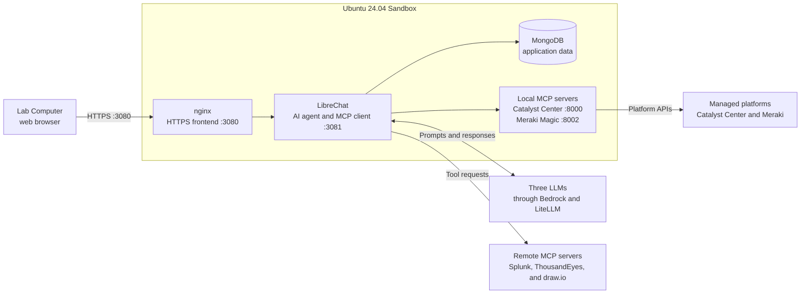

# MCP AI Agent Lab Guide

Developed by Gabi Zapodeanu, PTME + Cursor/GPT-5.6 Sol

## How to use this guide

This guide uses two location names:

- **Lab Computer** — the student's computer. Use it to open a terminal, connect
  to the Sandbox, and open LibreChat in a browser.
- **Sandbox** — the Ubuntu 24.04 system where the lab software runs.
  Run all installation, configuration, `make`, and `curl` commands here.

Do not run a command until its **Where** label matches your current location.
Complete the chapters in order:

1. Clone the code
2. Install and configure the Catalyst Center MCP server
3. Install and configure the Meraki Magic MCP server
4. Install and configure the LibreChat AI agent
5. Test the infrastructure
6. Test the AI agent
7. Review the lab and walk-away items

Each task explains what it does, why it is needed, and what successful output
looks like. Stop when a verification fails.

## Before You Begin: VPN and Sandbox Access

The instructor completes the following placeholders in a private handout or
learning-management system. Never replace them with real credentials in the
public Git repository.

```text
VPN access
  Client/application: <vpn-client>
  Endpoint:           <vpn-endpoint>
  Username:           <vpn-username>
  Password:           <provided-privately>

Ubuntu Sandbox access
  Hostname or IP:     <sandbox-host>
  Username:           <sandbox-user>
  Password:           <provided-privately>

LibreChat access
  Account procedure:  <signup-or-login-instructions>
  Username/email:     <student-account>
  Password:           <provided-privately>
```

Before opening the Sandbox:

1. Open `<vpn-client>` on the Lab Computer.
2. Connect to `<vpn-endpoint>`.
3. Authenticate with the privately supplied VPN username and password.
4. Confirm that the VPN reports **Connected**.

If VPN authentication fails, stop and contact the instructor. Do not expose
the Sandbox directly to the Internet. Also confirm that the instructor has
already installed the protected `$HOME/lab.env` file on the Sandbox.

Chapter 1 provides the SSH connection, Ubuntu verification, protected
configuration check, and public `git clone` command.

## Lab Introduction

### Lab goal

In this lab, you will assemble and test a self-hosted network AI agent. The
agent uses LibreChat as its browser interface and MCP client, connects to three
Large Language Models (LLMs) through two providers, and uses tools from
Catalyst Center, Meraki, Splunk, ThousandEyes, and draw.io.

The goal is not only to start the applications. You will follow a prompt from
the browser through the selected AI model and MCP server to the underlying
platform API, then review the grounded result returned to LibreChat.

### What you will do

During the lab, you will:

1. connect to an Ubuntu 24.04 Sandbox and clone the public lab repository;
2. prepare and review the Catalyst Center and Meraki Magic MCP servers;
3. install the LibreChat application stack and connect its models and MCP
   servers;
4. start and verify the complete stack with the root Makefile; and
5. ask single-platform and multi-platform questions through the AI agent.

All platform and service-integration credentials required for the lab are
already provisioned in your limited-time Sandbox. Students only create or sign
in to a local LibreChat account using the shared lab password provided by the
instructor.

### Application stack overview



The Lab Computer connects to the Sandbox. nginx provides the LibreChat HTTPS
frontend, LibreChat connects to the selected AI model and MCP servers, and the
MCP servers retrieve information from the managed platforms. MongoDB stores
LibreChat accounts, conversations, and application state.

### Operational model

The repository root Makefile provides the primary operational workflow:

```bash
make up
make status
```

- `make up` starts the two default local MCP servers and LibreChat.
- `make status` reports local listeners and health, remote MCP connectivity,
  and model configuration.
- `make down` stops the local application stack, but is reserved for
  instructor-directed cleanup or troubleshooting. Students leave the stack
  running at the end of this lab.

After cloning the repository, students can check their build progress at any
time without activating the virtual environment:

```bash
cd "$HOME/mcp-ai-agent-lab"
python3 scripts/check_lab_progress.py
```

The checker reports the completed milestones, the first incomplete
checkpoint, and the next action without displaying credentials or platform
data. After all local checkpoints pass, add `--live` to include remote MCP and
model-provider status.

The detailed chapters explain what each layer does, why it is required, how to
verify it, and how to distinguish an infrastructure failure from a model,
tool, authentication, or platform API failure.

## Chapter 1: Clone the Code

### What this chapter does

This chapter establishes the common starting point for the lab. It connects
the Lab Computer to the Ubuntu 24.04 Sandbox, installs the command-line tools
used by later exercises, clones the public lab repository, installs Python
3.13 with `uv`, and creates the shared virtual environment with the tested
Python dependency set.

### Why this chapter is needed

Every later chapter assumes the repository is available at the same path and
that its Python environment is active. The Catalyst Center MCP server, Meraki
Magic MCP server, LibreChat launcher, scripts, and guide are delivered
together so their tested versions remain aligned. One shared virtual
environment avoids duplicate installations and dependency-version conflicts.

The repository also includes `docs/setup-full-lab.sh`, which automates the
Ubuntu package, MongoDB, Node.js, locked Python dependency, configuration, and
LibreChat installation steps. Students should follow the detailed steps in
this guide unless the instructor explicitly directs them to use the automated
installer.

### 1.1 Connect to the Sandbox

**Where:** Lab Computer

**What:** Opens an encrypted SSH session from the Lab Computer to the Ubuntu
Sandbox. After login, the terminal prompt represents the remote Sandbox rather
than the Lab Computer.

**Why:** The lab services, source code, credentials, and runtime dependencies
are hosted on the Sandbox. Connecting first ensures that installation and
service commands do not accidentally run on the student's Lab Computer.

Open a terminal and connect with the username and hostname supplied by the
instructor:

```bash
ssh <sandbox-user>@<sandbox-host>
```

Accept the host key only after confirming its fingerprint with the instructor.

**Example verification output:**

```text
Welcome to Ubuntu 24.04 LTS
<sandbox-user>@<sandbox-host>:~$
```

The prompt shown after login belongs to the **Sandbox**. Run the remaining
shell commands there unless a task explicitly says **Lab Computer**.

### 1.2 Confirm the Sandbox operating system

**Where:** Sandbox

**What:** Displays the Sandbox operating-system release and CPU architecture
reported by Ubuntu.

**Why:** Package names, the MongoDB repository, and binary dependencies depend
on the operating-system release and architecture. Confirming Ubuntu 24.04
prevents later installation failures caused by using an unsupported image.

```bash
. /etc/os-release
printf 'Operating system: %s %s\nArchitecture: ' "$NAME" "$VERSION_ID"
uname -m
printf '\n'
```

**Example verification output:**

```text
Operating system: Ubuntu 24.04
Architecture: x86_64
```

Continue only when the release is `24.04`.

The example uses `x86_64`; the lab installer also supports Ubuntu 24.04 on
`aarch64`.

### 1.3 Install common packages

**Where:** Sandbox

**What:** Installs the common command-line utilities used throughout the lab:
Git for downloading source, Python bootstrap tools for the virtual
environment, `curl` for endpoint tests, `make` for service management, OpenSSL
for TLS, and `lsof` for listener checks.

**Why:** The remaining steps assume these utilities are present and call them
directly. Installing and verifying them together produces an early, clear
failure instead of an unexplained missing-command error later in the lab.

```bash
sudo apt update
sudo apt install -y \
  ca-certificates curl git gnupg less lsof make openssl pipx \
  python3-pip python3-venv
```

Verify the commands:

```bash
for command in curl git less lsof make openssl pipx; do
  command -v "$command" || exit 1
done
echo "Common packages are ready"
printf '\n'
```

**Example verification output:**

```text
/usr/bin/curl
/usr/bin/git
/usr/bin/less
/usr/bin/lsof
/usr/bin/make
/usr/bin/openssl
/usr/bin/pipx
Common packages are ready
```

### 1.4 Clone the lab repository

**Where:** Sandbox

**What:** Clones the public GitHub repository into
`$HOME/mcp-ai-agent-lab` and defines that directory as `LAB_ROOT`. The clone
contains both MCP servers, the LibreChat launcher, shared scripts, and this
guide.

**Why:** Scripts and Make targets resolve component paths relative to one
repository root. Using the documented directory keeps those paths consistent
and avoids separately cloned components with incompatible versions.

The repository is public. Students do not need a GitHub account, token, or
GitHub login to clone it.

```bash
cd "$HOME"
git clone https://github.com/zapodeanu/mcp_agents_ai_lab_LTRXAR-2194.git \
  mcp-ai-agent-lab
cd "$HOME/mcp-ai-agent-lab"
export LAB_ROOT="$PWD"
```

Verify the clone:

```bash
test -f "$LAB_ROOT/Makefile"
test -f "$LAB_ROOT/platforms-mcp-servers-oss/catalyst_center_remote.py"
test -f "$LAB_ROOT/meraki-magic-mcp-community/meraki_magic_remote.py"
test -f "$LAB_ROOT/ai-agent-librechat-oss/librechat.yaml"
printf 'Lab root: %s\nRepository files: OK\n\n' "$LAB_ROOT"
```

**Example verification output:**

```text
Lab root: /home/student/mcp-ai-agent-lab
Repository files: OK
```

Do not clone the component repositories separately; the required versions are
already included.

### 1.5 Install Python 3.13

**Where:** Sandbox

**What:** Installs the `uv` Python tool and uses it to install the lab-tested
Python 3.13 runtime alongside Ubuntu's system Python.

**Why:** Both local MCP servers and the validation scripts must run with one
consistent Python version. A separate `uv` installation provides Python 3.13
without replacing or modifying the Python version required by Ubuntu.

```bash
if ! command -v pipx >/dev/null 2>&1; then
  sudo apt update
  sudo apt install -y pipx
fi
pipx ensurepath
export PATH="$HOME/.local/bin:$PATH"
command -v uv >/dev/null 2>&1 || pipx install uv
uv python install 3.13
uv run --python 3.13 python --version
printf '\n'
```

**Example verification output:**

```text
Installed Python 3.13.x
Python 3.13.x
```

### 1.6 Create the shared Python environment

**Where:** Sandbox

**What:** Creates the repository-local `.venv`, activates it, and installs the
exact dependency set tested with the Catalyst Center and Meraki Magic MCP
servers.

**Why:** The virtual environment isolates lab packages from Ubuntu's
system-managed Python packages and gives both servers one compatible dependency
set. It also gives later scripts a predictable Python executable at
`$LAB_ROOT/.venv/bin/python`.

```bash
cd "$LAB_ROOT"
uv venv --python 3.13 --seed .venv
source "$LAB_ROOT/.venv/bin/activate"
uv pip install \
  --python "$LAB_ROOT/.venv/bin/python" \
  -r requirements.lock
```

Verify the environment:

```bash
test "$VIRTUAL_ENV" = "$LAB_ROOT/.venv"
python3 -c \
  'import sys; assert sys.version_info[:2] == (3, 13); print(sys.version.split()[0])'
printf 'Python path: %s\n' "$(command -v python3)"
printf '\n'
```

**Example verification output:**

```text
3.13.x
Python path: /home/student/mcp-ai-agent-lab/.venv/bin/python3
```

If you disconnect from SSH and need to reconnect to the Sandbox, run these
commands before continuing the lab. They return you to the lab directory and
reactivate its Python environment:

```bash
cd "$HOME/mcp-ai-agent-lab"
export LAB_ROOT="$PWD"
source "$LAB_ROOT/.venv/bin/activate"
```

### Chapter 1 summary

In this chapter, you:

- connected the Lab Computer to the Ubuntu 24.04 Sandbox;
- installed and verified the common command-line tools;
- cloned the public lab repository into the standard lab directory;
- installed the lab-tested Python 3.13 runtime; and
- created the shared virtual environment and installed its tested dependency
  set.

The Sandbox now has the source code and Python runtime required by both local
MCP servers and the remaining lab chapters.

**End-of-chapter progress check:**

```bash
cd "$HOME/mcp-ai-agent-lab"
python3 scripts/check_lab_progress.py
```

Confirm the completed checkpoints pass. The checker may identify a later
chapter as the next action; that is expected while the lab is still in
progress.

## Chapter 2: Install and Configure the Catalyst Center MCP Server

### What this chapter does

This chapter prepares the Catalyst Center integration used by LibreChat. It
verifies the Python dependencies, confirms that the required settings are
present, reviews the configured controller inventory, and explains the
available tool catalog. The MCP server listens on HTTPS port `8000`, protects
the MCP endpoint with a shared API-key security control, and provides
purpose-built tools curated from the Catalyst Center OpenAPI specifications
for inventory, assurance, diagnostics, and task results. It also exposes an
API Explorer across the broader Catalyst Center OpenAPI catalog. API Explorer
execution is restricted to read-only `GET` requests.

### Why this chapter is needed

LibreChat does not call Catalyst Center directly; it discovers tools and sends
tool requests through this MCP server. The server therefore needs at least one
enabled controller, valid platform credentials, the correct Python
dependencies, and the shared transport key. Reviewing these inputs separately
makes controller, authentication, and tool-discovery problems easier to
identify before the complete stack is started.

### Catalyst Center MCP critical files

The Catalyst Center MCP implementation is under
`platforms-mcp-servers-oss/`. Its critical files are:

- `catalyst_center_core.py` — all controller authentication, cluster
  selection, tool generation, API Explorer, API execution, and MCP tool logic.
- `Resources/catalyst_center_tools.yaml` — curated tool names, descriptions,
  endpoints, methods, and parameter definitions.
- `Resources/catalyst_center_clusters.yaml` — controller inventory and
  in-service state.
- `Resources/catalyst_center_openapi.json` — broader Catalyst Center OpenAPI
  catalog used to build API Explorer embeddings and endpoint metadata.
- `Resources/meraki_openapi.json` — Meraki OpenAPI catalog used by the
  optional bundled Meraki MCP server in this component. It is retained so that
  server's API Explorer can also be run, but it is not used by the Meraki Magic
  server installed later in this lab.
- `embeddings_assets/` — the local sentence-transformer model and cached
  vectors used for semantic API proximity search.
- `catalyst_center_stdio.py` — thin stdio transport wrapper around the core.
- `catalyst_center_remote.py` — thin HTTPS streamable HTTP wrapper around the
  core; this is the wrapper used by the lab.
- `logging_config.py` — shared structured logging configuration for the
  transport wrappers and core.
- `requirements.txt` — Python packages required by the bundled platform MCP
  servers.
- The repository-root `requirements.lock` — exact direct and transitive
  package versions validated for the complete student lab.

The core contains the platform and tool behavior. The stdio and remote files
only expose that same core through different MCP transports. The following
subchapters describe tool publication, execution, and transport in more detail.

### Catalyst Center tool catalog

The current catalog contains 22 purpose-built tools curated from the Catalyst
Center OpenAPI specifications and four API Explorer tools:

API Explorer converts each OpenAPI operation's summary, description, path, and
tags into a vector embedding using a local sentence-transformer model. It
caches those vectors locally and compares a student's natural-language query
with them using cosine similarity, returning the closest matching operations.
The HTTP method, operation ID, parameters, category, summary, description,
tags, and path are stored alongside each vector as metadata. API Explorer uses
that metadata to describe a match and explain how to call the endpoint. No
external vector database is required. The OpenAPI catalog contains multiple
HTTP methods, but the MCP execution tool enforces read-only access by rejecting
every method except `GET`.

API Explorer follows a four-stage workflow:

1. **Discover:** `explore_catalyst_api_endpoints` embeds a natural-language
   query and ranks similar OpenAPI operations. The request can be narrowed to
   the `inventory`, `assurance`, `operations`, or `administration` category,
   filtered to `GET`, and limited to between 1 and 50 results.
2. **Inspect:** `get_catalyst_endpoint_info` returns the selected operation's
   exact path, method, operation ID, description, tags, and OpenAPI parameter
   definitions. Inspect this metadata before execution; semantic similarity
   ranks likely matches but does not prove that the first match is correct.
3. **Execute:** `execute_catalyst_api_endpoint` accepts the exact path,
   `GET` method, a parameter object, and an optional cluster name. Values for
   placeholders such as `{id}` are inserted into the path; remaining values
   become query parameters. If no cluster is supplied, the first enabled
   cluster is used. Use `cluster: all` only when a prompt explicitly requires
   every enabled cluster.
4. **Review:** `get_catalyst_explorer_analytics` reports successful and failed
   dynamic calls, success rate, frequently used endpoints, and candidates that
   may deserve promotion into purpose-built curated tools. Its `detailed`
   option includes recent call history.

The Explorer search intentionally separates operations already represented by
curated YAML tools from newly explored operations. Prefer a curated tool when
one exists because it has a purpose-specific schema, validation, and error
handling. Use Explorer for API coverage that is not already available as a
curated tool. Never invent a required identifier: retrieve it with a
read-only tool first, or stop before execution and report what is missing.

- **Sites and inventory**
  - `get_site_count` — count sites.
  - `get_sites` — list areas, buildings, and floors.
  - `get_site_topology` — retrieve site topology.
  - `get_network_devices_count` — count devices using optional filters.
  - `get_network_devices` — retrieve device details and identifiers.
  - `get_compliance_detail` — retrieve device compliance information.
- **Assurance**
  - `get_issues_count` — count assurance issues.
  - `get_issues` — list issues using bounded filters.
  - `get_issue_details` — retrieve one issue and its suggested actions.
  - `get_clients_count` — count network clients.
  - `get_clients` — retrieve client health and analytics.
  - `get_interfaces_count` — count interfaces.
  - `get_device_interfaces` — retrieve device interface statistics.
- **Diagnostics and task results**
  - `run_read_only_commands` — request diagnostic CLI commands through
    Catalyst Center's command-runner read API.
  - `get_config_changes` — run predefined configuration-audit commands.
  - `get_task_status` and `get_task_detail` — inspect tasks started through
    this MCP server.
  - `download_file` — retrieve command output or report files.
  - `get_business_api_execution_results` — inspect Business API execution
    results.
  - `execute_issue_suggested_actions` — run Catalyst Center's predefined
    diagnostic and issue-assessment commands for an existing issue. The
    commands collect information needed to determine the remediation; they do
    not create configuration objects or apply the remediation.
- **Administration and guidance**
  - `get_clusters` — list enabled Catalyst Center clusters.
  - `help` — show recommended tool sequences and parameter guidance.
- **API Explorer**
  - `explore_catalyst_api_endpoints` — search the broader Catalyst Center API
    catalog using semantic proximity.
  - `get_catalyst_endpoint_info` — inspect an endpoint's method and parameters.
  - `execute_catalyst_api_endpoint` — call a discovered endpoint using `GET`
    only; non-`GET` methods are rejected by the server.
  - `get_catalyst_explorer_analytics` — review Explorer usage and results.

The authoritative purpose-built catalog is
`platforms-mcp-servers-oss/Resources/catalyst_center_tools.yaml`. The two
catalogs work together: use a purpose-built tool when one exists, then use API
Explorer to discover additional API coverage. The MCP server provides access
to read-only API Explorer tools and methods.

The MCP server loads the purpose-built tool catalog during startup. Changes to
`catalyst_center_tools.yaml` take effect only after the MCP server is
restarted.

### How curated Catalyst Center tools are published and executed

At startup, `catalyst_center_core.py` reads every entry in
`catalyst_center_tools.yaml`. For each entry it generates an asynchronous
FastMCP function with the configured name, description, and parameter schema,
then adds that function to the server's tool catalog. MCP clients discover the
generated catalog through the MCP tool-list operation. When a client invokes a
generated tool, the core validates its parameters, selects one controller or
`all` enabled controllers, obtains a Catalyst Center token, calls the
configured API endpoint with HTTPX, and returns the result through MCP.

### Catalyst Center MCP transport options

`catalyst_center_stdio.py` and `catalyst_center_remote.py` are thin wrappers
around `catalyst_center_core.py`. Both import the same FastMCP builder and add
only transport-specific startup behavior; neither contains Catalyst Center
tool or API logic.

- **stdio:** `catalyst_center_stdio.py` exposes the core over standard
  input/output for an MCP client that launches the server as a local child
  process. The option is included in the repository but is not used by this
  lab.
- **Remote HTTPS:** `catalyst_center_remote.py` exposes the core over
  streamable HTTP, adds `/health` and the `X-API-Key` security control, and
  configures optional TLS. This is the lab transport and listens with HTTPS on
  port `8000`.

The lab Catalyst Center controllers use self-signed certificates. For the
Sandbox-to-controller connection, the core intentionally disables certificate
verification when it requests a token or calls a controller API. This
lab-only exception is separate from the local MCP certificate validated in
Chapter 5. Production deployments should trust the controller's issuing CA
and enable certificate verification.

### Related optional Meraki MCP implementation

The following information is provided as a reference only. Students do not
install, configure, or run this optional server during the lab.

The repository also includes a similarly structured Meraki MCP implementation
in `platforms-mcp-servers-oss/meraki_core.py`, `meraki_stdio.py`, and
`meraki_remote.py`. Its stdio and remote files are also thin transport wrappers
around `meraki_core.py`. That optional server uses port `8001`, but it is not
used in this lab. This lab uses the separate Meraki Magic MCP server described
in Chapter 3 on port `8002`.

The optional server publishes 13 read-only tools from
`Resources/meraki_tools.yaml`:

- **Organization and network discovery:** `get_configured_organizations`,
  `list_organizations_details`, `list_networks`, and `get_network`.
- **Devices and clients:** `list_devices`, `get_network_clients`,
  `get_device_clients`, `get_client_details`, and `search_client_by_mac`.
- **Changes and assurance:** `get_organization_configuration_changes`,
  `get_organization_health_alerts`, `get_organization_alerts_overview`, and
  `get_alert_details`.

It also publishes four API Explorer tools backed by
`Resources/meraki_openapi.json`:

- `explore_meraki_api_endpoints` — find relevant Meraki API operations using
  natural-language semantic search.
- `get_meraki_endpoint_info` — review a discovered operation's method,
  parameters, and usage information.
- `execute_meraki_api_endpoint` — execute a discovered `GET` operation;
  non-`GET` methods are not accepted.
- `get_meraki_explorer_analytics` — review Explorer usage and results.

These 17 tools belong to the optional Meraki MCP server on port `8001`. They
are separate from the Meraki Magic tools described in Chapter 3.

### 2.1 Verify the Catalyst Center installation

**Where:** Sandbox

**What:** Imports the HTTPX client, FastMCP framework, and Uvicorn web server
from the shared virtual environment. These packages provide direct Catalyst
Center API access, MCP tool transport, and the HTTPS application server.

**Why:** The Catalyst Center MCP process cannot initialize if any of these
runtime layers is missing or installed in the wrong Python environment.
Testing imports now isolates dependency problems before controller
authentication and MCP startup are tested.

```bash
cd "$LAB_ROOT"
source "$LAB_ROOT/.venv/bin/activate"
python3 - <<'PY'
import httpx
import uvicorn
from mcp.server.fastmcp import FastMCP
print("Catalyst Center Python dependencies: OK")
print()
PY
```

**Example verification output:**

```text
Catalyst Center Python dependencies: OK
```

### 2.2 Verify the private Catalyst Center settings

**Where:** Sandbox

**What:** Checks for three required values without displaying them.
`MCP_API_KEY` is an API-key security control: LibreChat sends this shared
credential in the `X-API-Key` header when it calls the MCP endpoint. `CC_USER`
and `CC_PASS` are the username and password the MCP server uses to authenticate
API requests to the enabled Catalyst Center controller.

**Why:** These values protect two different connections. The MCP API key
prevents clients without the shared key from invoking tools, while the
Catalyst Center username and password authorize the server to retrieve
controller data. The server refuses to start without the transport key, and
tool calls fail if the controller credentials are absent or invalid.

```bash
python3 - <<'PY'
from pathlib import Path
from dotenv import dotenv_values

values = dotenv_values(Path.home() / "lab.env")
for name in ("MCP_API_KEY", "CC_USER", "CC_PASS"):
    value = values.get(name)
    configured = bool(value) and not str(value).lower().startswith("replace")
    print(f"{name}: {'set' if configured else 'MISSING'}")
print()
PY
```

**Example verification output:**

```text
MCP_API_KEY: set
CC_USER: set
CC_PASS: set
```

If any value is `MISSING`, stop and ask the instructor.

### 2.3 Review the Catalyst Center inventory

**Where:** Sandbox

**What:** Displays the Catalyst Center controller inventory used by the MCP
server. The file identifies each controller by name and host and records its
software version, location, and in-service state.

**Why:** The MCP server loads only controllers whose `enabled` value is
`true`. Tool calls use a configured controller name as the `cluster` parameter,
or the keyword `all` to query all enabled controllers. Reviewing the inventory
confirms where requests will be sent and prevents calls to an out-of-service
controller.

Display the inventory file without changing it:

```bash
cd "$LAB_ROOT"
cat platforms-mcp-servers-oss/Resources/catalyst_center_clusters.yaml
printf '\n'
```

**Example verification output:**

```yaml
catalyst_centers:
  - name: "Lab"
    host: "128.107.255.252"
    version: "3.2.3"
    location: "SJC"
    enabled: true

  - name: "LakeO"
    host: "10.93.141.45"
    version: "3.2.3"
    location: "PDX"
    enabled: false
```

- `name` is the controller name used by the MCP tool `cluster` parameter.
- `host` is the controller hostname or IP address without `https://`.
- `version` and `location` describe the controller.
- `enabled: true` means the controller is in service.
- `enabled: false` means the controller is out of service.

For this lab, confirm that `Lab` is in service and `LakeO` is out of service.
Do not change this file. The MCP server reads the controller inventory during
startup, so changing a controller between in-service and out-of-service states
requires an MCP server restart.

### Chapter 2 summary

In this chapter, you:

- verified the HTTP client, MCP framework, and web-server dependencies;
- confirmed the MCP API-key security control and Catalyst Center account
  settings are present;
- reviewed the OpenAPI-derived purpose-built tool catalog;
- learned how API Explorer uses local vector embeddings and cosine similarity
  to find additional read-only API operations; and
- confirmed which Catalyst Center controllers are in service.

The Catalyst Center MCP configuration is ready to start and test in Chapter 5.

**End-of-chapter progress check:**

```bash
cd "$HOME/mcp-ai-agent-lab"
python3 scripts/check_lab_progress.py
```

Confirm the earlier checkpoints still pass, then continue with the next action
reported by the checker.

## Chapter 3: Install and Configure the Meraki Magic MCP Server

### What this chapter does

This chapter prepares the Meraki Magic integration used by LibreChat. It
verifies the Python and Meraki SDK dependencies, checks the selected
organization and API configuration, confirms the shared MCP API-key security
control, and verifies that read-only mode is enabled. The server listens on
HTTPS port `8002` and provides curated tools plus dynamic discovery across the
installed Meraki SDK.

### Why this chapter is needed

Meraki Dashboard exposes a large API surface that changes as the SDK evolves.
Dynamic discovery allows the agent to find relevant methods without defining
every method manually, but calls still require the correct organization and an
authorized Dashboard API key. Read-only mode is required because it provides
a server-side guard that blocks SDK methods classified by the configured
write-operation policy. The exercises in this guide deliberately select
read-only methods.

### Meraki Magic critical files

The Meraki Magic implementation is under `meraki-magic-mcp-community/`. Its
critical files are:

- `meraki-mcp-dynamic.py` — Meraki SDK client, generated method index, 22 MCP
  tools, caching, response-size handling, and the read-only operation guard.
- `meraki_mcp_config.py` — shared configuration defaults, operation
  classification, write blocking, and destructive-operation confirmation.
- `meraki_magic_remote.py` — secured HTTPS streamable HTTP wrapper used by the
  lab on port `8002`.
- `requirements.txt` — Python packages required by this component.
- `tests/test_config_and_safety.py` — tests for configuration, method safety,
  parameter handling, and remote transport authentication.
- `meraki-mcp.py` — an alternative manually curated Meraki server included in
  the component repository but not used by this lab.

Unlike Catalyst Center's YAML-generated curated catalog, Meraki Magic builds
its broad method catalog by inspecting the installed Meraki Python SDK.

### Meraki Magic tool catalog and execution

Meraki Magic uses the installed Meraki Python SDK as its API catalog. At
startup it indexes SDK sections and callable method names. It inspects method
signatures, required parameters, and docstrings when a method is reviewed or
called. It publishes 22 MCP tools:

- **Twelve common Dashboard tools** provide direct access to organizations,
  administrators, networks, devices, clients, events, wireless SSIDs, and
  switch ports. Eleven are read operations; `updateDeviceSwitchPort` is
  blocked while read-only mode is enabled.
- `call_meraki_api` is the generic SDK caller. It accepts an SDK section,
  method name, and parameter object, providing access to the broader installed
  SDK without manually defining every Dashboard method.
- `list_all_methods`, `search_methods`, and `get_method_info` expose the
  generated SDK catalog so a model can discover a method and inspect its
  parameters before calling it.
- Six configuration and cache tools report runtime configuration, inspect or
  clear the in-memory cache, and retrieve, list, or remove large responses
  cached on disk.

Before an SDK method executes, the server validates its section and method,
checks required parameters, supplies the configured organization ID when
applicable, applies pagination limits, and enforces the read-only operation
guard. Changes to the installed SDK or Meraki Magic tool code require an MCP
server restart because the method catalog is built during startup.

### Meraki Magic transport options

`meraki-mcp-dynamic.py` owns the SDK and MCP tool logic and can run directly
with stdio or streamable HTTP transport. The lab does not launch either direct
transport; it uses the secured remote wrapper instead.

`meraki_magic_remote.py` is the thin remote wrapper used by the lab. It loads
the FastMCP object from `meraki-mcp-dynamic.py`, adds `/health` and the
`X-API-Key` security control, and serves the same tool catalog over HTTPS
streamable HTTP on port `8002`. It does not duplicate Meraki SDK or tool logic.

### 3.1 Verify the Meraki Magic installation

**Where:** Sandbox

**What:** Imports the Meraki Python SDK and FastMCP framework from the shared
virtual environment.

**Why:** These are the primary dependencies used by Meraki Magic for Dashboard
API access and MCP transport. Verifying the imports first separates package
installation failures from later module startup, API-key, organization, and
network-connectivity failures.

```bash
cd "$LAB_ROOT"
source "$LAB_ROOT/.venv/bin/activate"
python3 - <<'PY'
import meraki
from mcp.server.fastmcp import FastMCP
print("Meraki Magic Python dependencies: OK")
print()
PY
```

**Example verification output:**

```text
Meraki Magic Python dependencies: OK
```

### 3.2 Verify the private Meraki settings

**Where:** Sandbox

**What:** Checks that `MERAKI_API_KEY`, `MERAKI_ORG_ID`, and the shared
`MCP_API_KEY` are configured, then confirms `READ_ONLY_MODE=true`.
The Meraki key authenticates Dashboard API requests, the organization ID
defines the lab organization, and the MCP key authenticates LibreChat calls to
the local MCP endpoint.

**Why:** Each value controls a separate boundary: platform authentication,
organization scope, or MCP transport access. `READ_ONLY_MODE=true` adds a
server-side safety control that rejects SDK methods classified as write
operations. The lab exercises use explicitly read-only methods.

```bash
python3 - <<'PY'
from pathlib import Path
from dotenv import dotenv_values

values = dotenv_values(Path.home() / "lab.env")
for name in ("MCP_API_KEY", "MERAKI_API_KEY", "MERAKI_ORG_ID"):
    value = values.get(name)
    configured = bool(value) and not str(value).lower().startswith("replace")
    print(f"{name}: {'set' if configured else 'MISSING'}")

read_only = str(values.get("READ_ONLY_MODE", "")).lower() == "true"
print(f"READ_ONLY_MODE: {'true' if read_only else 'INVALID; ask instructor'}")
print()
raise SystemExit(0 if read_only else 1)
PY
```

**Example verification output:**

```text
MCP_API_KEY: set
MERAKI_API_KEY: set
MERAKI_ORG_ID: set
READ_ONLY_MODE: true
```

Stop and ask the instructor if a value is missing or read-only mode is not
`true`.

### Chapter 3 summary

In this chapter, you:

- verified the Meraki SDK and FastMCP dependencies;
- confirmed the Meraki API key, organization scope, and MCP API-key security
  control are configured;
- verified that server-side read-only mode is enabled.

The Meraki Magic MCP configuration is ready to start and test in Chapter 5.

**End-of-chapter progress check:**

```bash
cd "$HOME/mcp-ai-agent-lab"
python3 scripts/check_lab_progress.py
```

Confirm the earlier checkpoints still pass. Runtime checkpoints are not
expected to pass until the complete stack is started in Chapter 5.

## Chapter 4: Install and Configure the LibreChat AI Agent

### What LibreChat is

LibreChat is an open-source, self-hosted chat application. It provides the
browser interface, user accounts, conversation history, model selection, and
MCP client used in this lab. LibreChat is not an AI model itself. It sends each
conversation to the selected model provider and makes the enabled MCP tools
available to that model.

For this lab, LibreChat is the common workspace where students can select an
AI model, ask a network-operations question, review proposed MCP tool calls,
and inspect the returned Catalyst Center, Meraki, Splunk, ThousandEyes, or
draw.io results.

### What the lab requires and includes

The LibreChat runtime requires Node.js `24.22.1`, npm `11.13.0`, MongoDB
Community 8.0, nginx, the lab TLS certificate, and the model and MCP settings
provided to the application at startup. It also requires outbound access to
the configured cloud model providers and remote MCP servers. The two local MCP
servers must be reachable from the Sandbox on ports `8000` and `8002`.

Each local runtime component has a separate role:

- **Node.js** is the JavaScript runtime that executes the LibreChat backend and
  its build tools. The backend handles authentication, conversations, model
  requests, and MCP connections. In this lab it listens only on
  `127.0.0.1:3081`, so it is not directly exposed to the Lab Computer.
- **npm** is the package manager and command runner for the Node.js project. It
  installs the exact LibreChat dependencies and runs the commands that build
  the browser client. npm is required during installation and rebuilds; it is
  not a separate network service.
- **MongoDB** is LibreChat's persistent data store. Its `mongod` service stores
  user accounts, login sessions, conversations, messages, and application
  state so they remain available when the Node.js process restarts. LibreChat
  cannot provide normal login and conversation behavior if `mongod` is not
  reachable.
- **nginx** is the externally reachable HTTPS reverse proxy. It listens on all
  Sandbox interfaces on port `3080`, negotiates TLS 1.3 with the browser, and
  forwards HTTP and WebSocket traffic to the loopback-only LibreChat backend
  on port `3081`. This allows access from the Lab Computer without exposing the
  backend process directly or requiring LibreChat itself to manage TLS.

The lab repository does not contain a modified copy of the complete LibreChat
source tree. Instead, it includes a reproducible integration in
`ai-agent-librechat-oss/`. The setup script clones a pinned upstream LibreChat
revision into `ai-agent-librechat-oss/librechat-src/`, installs its
dependencies, builds the browser client, and applies the lab's compact MCP
selector customization.

The included integration provides:

- three configured LLM profiles through two providers: Claude Sonnet 4.6
  through AWS Bedrock, plus SharonAI Gemma and Claude Haiku through LiteLLM;
- five MCP connections: Catalyst Center, Meraki Magic, Splunk, ThousandEyes,
  and draw.io;
- a network-engineer system prompt and a compact MCP server selector;
- configuration synchronization and application lifecycle scripts; and
- an nginx HTTPS frontend on port `3080` that proxies to the LibreChat backend
  on `127.0.0.1:3081`.

The models and remote MCP services are configured integrations; their model
weights and service implementations are not downloaded into the repository.

AWS Bedrock is integrated directly for Claude Sonnet. LiteLLM is an external
model gateway that exposes SharonAI Gemma and Claude Haiku through one
OpenAI-compatible API. Using the gateway gives LibreChat one consistent API
format for both models and lets students switch between them without separate
provider-specific integrations. The custom LiteLLM endpoint assigns each
alias a conservative 32,768-token context budget so LibreChat can calculate
prompt capacity before sending a request.

Use the repository root Makefile whenever it provides the required operation:
`make up`, `make down`, and `make status` manage or inspect the complete stack,
while the `app-*` and `mcp-*` targets manage one layer. Run a script directly
only when no Make target exists, such as the one-time LibreChat installation
in section 4.7, or when an instructor is troubleshooting the implementation
behind a Make target.

### LibreChat critical files

The LibreChat lab integration is under `ai-agent-librechat-oss/`. Its critical
files are:

- the repository root `Makefile` — preferred student interface for starting,
  stopping, and checking the complete lab or one service layer.
- `Makefile` — component-level LibreChat start, stop, and status targets used
  by the root workflow.
- `librechat.yaml` — defines the three model profiles, five MCP connections,
  network-engineer prompts, allowed MCP domains, and user-interface settings.
- `.nvmrc` — records the Node.js version used by this integration.
- `scripts/setup_local.sh` — clones the pinned LibreChat revision, installs
  dependencies, applies the compact-selector customization, and builds the
  browser client.
- `scripts/sync_config.sh` — copies the required runtime settings and
  `librechat.yaml` into the downloaded LibreChat source tree.
- `scripts/start_all.sh`, `scripts/start_suite_ssl.sh`, and
  `scripts/stop_suite.sh` — implementation scripts called by the Makefiles to
  verify prerequisites, prepare nginx, and start or stop LibreChat.
- `scripts/gen_secrets.sh` — creates missing LibreChat application secrets
  during initial setup.
- `nginx/local.conf.template` — nginx template for the public HTTPS listener
  and internal backend proxy.
- `patches/compact-mcp-selector.patch` and `overrides/` — reproducible
  user-interface customization for selecting MCP servers from one compact
  menu.
- `environment.env.example` — reference list and descriptions of supported
  runtime settings.

The generated `librechat-src/`, runtime logs, PID files, and nginx
configuration are installation artifacts rather than source files maintained
by students.

### What this chapter does

This chapter installs the LibreChat application and its supporting services:
the tested Node.js and npm versions, MongoDB, and nginx. It prepares the local
LibreChat runtime configuration, builds the web application, and reviews the
three configured LLMs provided through Bedrock and LiteLLM, plus five MCP
server connections that students will use from the browser.

### Why this chapter is needed

LibreChat is the user-facing AI agent and the MCP client that connects models
to network and observability tools. MongoDB stores local user accounts,
conversations, and application state. nginx exposes the HTTPS frontend on port
`3080` while the LibreChat backend remains internal on port `3081`. The model
and MCP configuration must be synchronized before startup so the browser shows
the intended providers and tools.

### 4.1 Install LibreChat operating-system packages

**Where:** Sandbox

**What:** Installs nginx. The certificate, download, signing-key, and
listener-inspection utilities needed by this chapter were installed in
Chapter 1.

**Why:** nginx provides the externally reachable HTTPS frontend while keeping
the LibreChat Node.js backend on an internal port.

```bash
sudo apt install -y nginx
```

Verify nginx:

```bash
nginx -v
printf '\n'
```

**Example verification output:**

```text
nginx version: nginx/1.x.x
```

### 4.2 Install Node.js and npm

**Where:** Sandbox

**What:** Installs nvm, uses it to install Node.js `24.22.1`, selects that
version as the default, and installs npm `11.13.0`.

**Why:** LibreChat's backend, dependency installation, and frontend build all
run on Node.js. Pinning Node.js and npm removes version-dependent build
differences and reproduces the runtime used to validate this lab.

```bash
NVM_INSTALLER="$(mktemp)"
trap 'rm -f "$NVM_INSTALLER"' EXIT
curl -fsSL \
  https://raw.githubusercontent.com/nvm-sh/nvm/v0.40.8/install.sh \
  -o "$NVM_INSTALLER"
bash "$NVM_INSTALLER"
rm -f "$NVM_INSTALLER"
trap - EXIT

export NVM_DIR="$HOME/.nvm"
[ -s "$NVM_DIR/nvm.sh" ] && . "$NVM_DIR/nvm.sh"
nvm install 24.22.1
nvm use 24.22.1
nvm alias default 24.22.1
npm install -g npm@11.13.0
node --version
npm --version
printf '\n'
```

The installer is downloaded to a temporary file before execution, matching the
repository bootstrap workflow.

**Example verification output:**

```text
v24.22.1
11.13.0
```

Do not continue with different versions.

### 4.3 Install MongoDB Community 8.0

**Where:** Sandbox

**What:** Adds MongoDB's signed Ubuntu 24.04 package repository, installs
MongoDB Community 8.0, and enables the `mongod` service to start now and after
a Sandbox reboot.

**Why:** LibreChat persists user accounts, sessions, settings, conversations,
and application state in MongoDB. Verifying both the service state and a
database ping confirms that the process is running and accepting requests
before LibreChat starts.

```bash
. /etc/os-release
case "$VERSION_ID" in
  24.04) MONGODB_UBUNTU_CODENAME="noble" ;;
  *) echo "Unsupported Ubuntu release: $VERSION_ID"; exit 1 ;;
esac

sudo install -m 0755 -d /usr/share/keyrings
curl -fsSL https://pgp.mongodb.com/server-8.0.asc | \
  sudo gpg --dearmor --yes \
    -o /usr/share/keyrings/mongodb-server-8.0.gpg

echo "deb [ arch=amd64,arm64 signed-by=/usr/share/keyrings/mongodb-server-8.0.gpg ] https://repo.mongodb.org/apt/ubuntu ${MONGODB_UBUNTU_CODENAME}/mongodb-org/8.0 multiverse" | \
  sudo tee /etc/apt/sources.list.d/mongodb-org-8.0.list

sudo apt update
sudo apt install -y mongodb-org
sudo systemctl enable --now mongod
```

Verify MongoDB:

```bash
systemctl is-active mongod
mongod --version | awk 'NR == 1'
mongosh --quiet --eval 'db.runCommand({ ping: 1 })'
printf '\n'
```

**Example verification output:**

```text
active
db version v8.0.x
{ ok: 1 }
```

Use the official `mongodb-org` package, not Ubuntu's conflicting `mongodb`
package.

### 4.4 Verify the private LibreChat settings

**Where:** Sandbox

**What:** Checks the presence of LibreChat's application secrets, MongoDB URI,
Bedrock and LiteLLM provider settings, local MCP transport key, and remote
Splunk and ThousandEyes settings without printing their values. It also
validates whether Bedrock uses a complete static credential pair or the
default AWS credential chain.

**Why:** Each group supports a different runtime function: `CREDS_KEY` and
`CREDS_IV` protect stored credentials; JWT secrets authenticate browser
sessions; `MONGO_URI` locates the database; provider settings authorize model
requests; and MCP credentials authorize tool connections. A missing value may
allow LibreChat to start but cause login, model, or tool failures later.

LibreChat uses two configuration layers:

- `ai-agent-librechat-oss/librechat.yaml` contains non-secret model profiles,
  MCP server definitions, endpoint URLs, prompts, and environment-variable
  references.
- The protected Sandbox runtime configuration supplies application secrets,
  database settings, provider credentials, and MCP authentication values.

All platform and service-integration credentials are already provisioned in
the Sandbox. During the one-time installation, `scripts/setup_local.sh` calls
`scripts/gen_secrets.sh` to create any missing LibreChat application-only
values. During setup and every application start, `scripts/sync_config.sh`
copies only the values required by LibreChat into its generated runtime
environment. Catalyst Center and Meraki platform credentials remain with
their MCP server processes because LibreChat does not authenticate directly
to those platforms.

```bash
cd "$LAB_ROOT"
source "$LAB_ROOT/.venv/bin/activate"
python3 - <<'PY'
from pathlib import Path
from dotenv import dotenv_values

values = dotenv_values(Path.home() / "lab.env")
required = (
    "CREDS_KEY",
    "CREDS_IV",
    "JWT_SECRET",
    "JWT_REFRESH_SECRET",
    "MEILI_MASTER_KEY",
    "MONGO_URI",
    "BEDROCK_AWS_DEFAULT_REGION",
    "BEDROCK_AWS_MODELS",
    "BEDROCK_INFERENCE_PROFILE_CLAUDE_SONNET",
    "LITELLM_API_KEY",
    "MCP_API_KEY",
    "SPLUNK_MCP_BEARER",
    "SPLUNK_MCP_EP",
    "THOUSANDEYES_API_KEY",
)
missing = []
for name in required:
    value = values.get(name)
    configured = bool(value) and not str(value).lower().startswith("replace")
    print(f"{name}: {'set' if configured else 'MISSING'}")
    if not configured:
        missing.append(name)

access_key = str(values.get("BEDROCK_AWS_ACCESS_KEY_ID") or "")
secret_key = str(values.get("BEDROCK_AWS_SECRET_ACCESS_KEY") or "")
session_token = str(values.get("BEDROCK_AWS_SESSION_TOKEN") or "")
credentials_valid = bool(access_key) == bool(secret_key)
if access_key.startswith("ASIA") and not session_token:
    credentials_valid = False
if not credentials_valid:
    credential_status = "INVALID"
elif access_key:
    credential_status = "static credential pair present"
else:
    credential_status = "default AWS chain selected"
print(
    f"Bedrock credential configuration: {credential_status}"
)
if not credentials_valid:
    missing.append("valid Bedrock credential configuration")
print()
raise SystemExit(1 if missing else 0)
PY
```

**Example verification output:**

```text
CREDS_KEY: set
CREDS_IV: set
...
THOUSANDEYES_API_KEY: set
Bedrock credential configuration: static credential pair present
```

An empty `BEDROCK_AWS_SESSION_TOKEN` is valid when the lab uses long-lived
credentials. The instructor may also use the standard AWS credential chain
instead of static Bedrock credentials.

### 4.5 Verify the Bedrock inference profile

**Where:** Sandbox

**What:** Validates the structure of the Bedrock system inference-profile ARN,
confirms that its region matches `BEDROCK_AWS_DEFAULT_REGION`, and verifies
that `BEDROCK_AWS_MODELS` selects the same profile by full ARN or profile ID.
The check does not display the ARN or AWS account ID.

**Why:** Bedrock uses the inference profile to route Claude requests across
supported AWS Regions. A syntactically present but mismatched profile, model
ID, or region can pass a basic configuration check and still fail when
LibreChat invokes the model.

```bash
python3 - <<'PY'
from pathlib import Path
import re
from dotenv import dotenv_values

values = dotenv_values(Path.home() / "lab.env")
region = str(values.get("BEDROCK_AWS_DEFAULT_REGION", ""))
models = {
    item.strip()
    for item in str(values.get("BEDROCK_AWS_MODELS", "")).split(",")
    if item.strip()
}
profile = str(values.get("BEDROCK_INFERENCE_PROFILE_CLAUDE_SONNET", ""))
match = re.fullmatch(
    r"arn:(?:aws|aws-us-gov|aws-cn):bedrock:"
    r"([a-z0-9-]+):[0-9]{12}:inference-profile/(.+)",
    profile,
)
valid = bool(
    match
    and match.group(1) == region
    and (profile in models or match.group(2) in models)
)
print(
    "Bedrock inference profile: valid system profile ARN"
    if valid
    else "Bedrock inference profile: INVALID; ask the instructor"
)
print()
raise SystemExit(0 if valid else 1)
PY
```

**Example verification output:**

```text
Bedrock inference profile: valid system profile ARN
```

### 4.6 Verify the Splunk endpoint format

**Where:** Sandbox

**What:** Parses the configured Splunk MCP endpoint and checks its HTTPS
scheme, standard TCP port `443`, `/en-US/splunkd/__raw/services/mcp` path, and
hostname membership in LibreChat's MCP domain allowlist. It does not display
the endpoint or bearer credential.

**Why:** Both routing and application policy must agree before LibreChat can
connect. The Splunk reverse proxy publishes MCP through a specific HTTPS path,
while LibreChat blocks outbound MCP connections to hosts not explicitly listed
in `allowedDomains`. Restricting the accepted URL prevents a prepared bearer
credential from being sent to an unintended host or route.

```bash
python3 - <<'PY'
from pathlib import Path
from urllib.parse import urlparse
from dotenv import dotenv_values
import yaml

endpoint = dotenv_values(Path.home() / "lab.env").get("SPLUNK_MCP_EP", "")
try:
    parsed = urlparse(endpoint)
    config = yaml.safe_load(
        Path("ai-agent-librechat-oss/librechat.yaml").read_text()
    )
    allowed = set(config["mcpSettings"]["allowedDomains"])
    valid = (
        parsed.scheme == "https"
        and parsed.hostname in allowed
        and parsed.port in (None, 443)
        and (
            parsed.path.rstrip("/")
            == "/en-US/splunkd/__raw/services/mcp"
        )
        and not parsed.username
        and not parsed.password
        and not parsed.query
        and not parsed.fragment
    )
except ValueError:
    valid = False
print("Splunk endpoint format: OK" if valid else "Splunk endpoint: INVALID")
print()
raise SystemExit(0 if valid else 1)
PY
```

**Example verification output:**

```text
Splunk endpoint format: OK
```

### 4.7 Install LibreChat

**Where:** Sandbox

**What:** Downloads the tested LibreChat source revision, installs its Node.js
dependencies, applies the lab's compact MCP selector customization, creates
the runtime configuration, and builds the browser frontend.

**Why:** The lab repository stores only the launcher, configuration, and
customization needed for a reproducible installation; the larger generated
source tree, dependency tree, and frontend build are created on the Sandbox.
Completing this step produces the backend and web assets that `make up`
starts.

```bash
cd "$LAB_ROOT/ai-agent-librechat-oss"
export NVM_DIR="$HOME/.nvm"
[ -s "$NVM_DIR/nvm.sh" ] && . "$NVM_DIR/nvm.sh"
nvm use 24.22.1
bash scripts/setup_local.sh
```

**Example successful ending:**

```text
Setup complete.
Start the complete lab from the repository root with: make up
```

Verify generated files:

```bash
test -d "$LAB_ROOT/ai-agent-librechat-oss/librechat-src/node_modules"
test -f \
  "$LAB_ROOT/ai-agent-librechat-oss/librechat-src/client/dist/index.html"
echo "LibreChat installation: OK"
printf '\n'
```

**Example verification output:**

```text
LibreChat installation: OK
```

### 4.8 Review the non-secret LibreChat configuration

**Where:** Sandbox

**What:** Reads the non-secret LibreChat YAML and lists the model labels plus
the names and destinations of all configured MCP servers.

**Why:** This provides a configuration-level preview of the three LLMs and five
MCP connections students should see in the browser. Comparing the YAML with
the expected list catches missing or renamed integrations before runtime
connectivity tests, without displaying credentials. The model presets do not
preselect MCP servers; students select only the server required by each
exercise. This avoids sending unrelated tool schemas to the model and
preserves its context budget.

```bash
cd "$LAB_ROOT"
python3 - <<'PY'
from pathlib import Path
import yaml

config = yaml.safe_load(Path("ai-agent-librechat-oss/librechat.yaml").read_text())
print("Models:")
for model in config["modelSpecs"]["list"]:
    print(f"  - {model['label']}")
print("MCP servers:")
for name, server in config["mcpServers"].items():
    target = server.get("url", server.get("type", "configured"))
    print(f"  - {name}: {target}")
print()
PY
```

**Example verification output:**

```text
Models:
  - Claude Sonnet 4.6 (Bedrock)
  - SharonAI Gemma (LiteLLM)
  - Claude Haiku (LiteLLM)
MCP servers:
  - catalyst-center-mcp: https://localhost:8000/mcp
  - meraki-magic-mcp: https://localhost:8002/mcp
  - splunk-mcp: stdio
  - thousandeyes-mcp: https://api.thousandeyes.com/mcp
  - drawio-mcp: https://mcp.draw.io/mcp
```

### Chapter 4 summary

In this chapter, you:

- installed the tested Node.js, npm, MongoDB, and nginx runtime components;
- validated the application, model-provider, and remote-MCP settings;
- confirmed the Bedrock inference profile and Splunk endpoint structure;
- downloaded, customized, and built LibreChat; and
- reviewed the three LLM choices and five MCP server connections presented to
  students.

LibreChat and its supporting services are installed and ready for the
end-to-end infrastructure tests in Chapter 5.

**End-of-chapter progress check:**

```bash
cd "$HOME/mcp-ai-agent-lab"
python3 scripts/check_lab_progress.py
```

The repository, host, Python, configuration, host-service, and LibreChat
installation checkpoints should pass. The local runtime can remain not ready
until Chapter 5.

## Chapter 5: Test the Infrastructure

### What this chapter does

This chapter starts the complete stack and validates it in layers. It checks
process listeners and TLS, calls both local MCP health endpoints, probes the
remote MCP services, opens LibreChat, and tests all three LLMs through the two
configured providers. The verified stack remains running for the AI-agent
exercises in Chapter 6.

### Why this chapter is needed

Successful installation proves only that files and packages are present. The
lab also depends on credentials, controller reachability, outbound network
paths, certificates, process startup, model-provider access, MCP
authentication, and browser access. Testing these layers before asking the
agent to use tools isolates infrastructure failures from model or tool-selection
behavior.

Open two Sandbox terminals:

- **Sandbox terminal A — services:** start and stop commands
- **Sandbox terminal B — tests:** `curl`, status, and log checks

In each terminal run:

```bash
cd "$HOME/mcp-ai-agent-lab"
export LAB_ROOT="$PWD"
source "$LAB_ROOT/.venv/bin/activate"
```

### 5.1 Start and check the complete stack

**Where:** Sandbox terminal A

**What:** Uses the root Makefile to validate configuration, prepare the shared
TLS certificate, and start the Catalyst Center MCP server, Meraki Magic MCP
server, LibreChat backend, and nginx HTTPS frontend. It then runs the combined
status check for the local services, remote MCP servers, and configured LLMs.

**Why:** The remaining tests exercise communication between live processes,
not merely installed files. Starting everything through one target applies the
tested ports, environment paths, TLS settings, and startup order consistently.
Running status immediately afterward confirms what started successfully and
identifies external services that are unavailable before the detailed tests.

```bash
cd "$LAB_ROOT"
make up
make status
```

**Example verification output (process IDs vary):**

```text
Required lab.env values are configured.
make[1]: Entering directory '/home/ubuntu/mcp-ai-agent-lab'
Required lab.env values are configured.
MCP TLS enabled with /home/ubuntu/mcp-ai-agent-lab/certs/mcp-selfsigned.crt
Catalyst Center MCP ready on port 8000
Meraki Magic MCP ready on port 8002
Required lab.env values are configured.
LibreChat ready on port 3080

Port 8000 (Catalyst Center MCP):
python  34287 ubuntu ... TCP *:8000 (LISTEN)

Port 8002 (Meraki Magic MCP):
python  34289 ubuntu ... TCP *:8002 (LISTEN)

Catalyst health (HTTPS):
{"status":"ok","service":"catalyst-center-mcp"}

Meraki Magic health (HTTPS):
{"status":"ok","service":"meraki-magic-mcp"}

Port 3080 (LibreChat HTTPS):
nginx  34809 ubuntu ... IPv4 ... TCP *:3080 (LISTEN)
nginx  34809 ubuntu ... IPv6 ... TCP *:3080 (LISTEN)
nginx  34810 ubuntu ... IPv4 ... TCP *:3080 (LISTEN)
nginx  34810 ubuntu ... IPv6 ... TCP *:3080 (LISTEN)

Port 3081 (LibreChat backend):
MainThrea  34791 ubuntu ... TCP 127.0.0.1:3081 (LISTEN)

LibreChat health (HTTPS):
OK: https://localhost:3080/

Remote MCP connectivity:
Splunk MCP: AVAILABLE
ThousandEyes MCP: AVAILABLE
draw.io MCP: AVAILABLE

LLM configuration checks:
Claude Sonnet 4.6 (Bedrock): REACHABLE (profile lookup not authorized)
SharonAI Gemma (LiteLLM): MODEL ADVERTISED
Claude Haiku (LiteLLM): MODEL ADVERTISED
```

If startup fails, inspect these files after removing any sensitive data before
sharing them:

```bash
less "$LAB_ROOT/logs/catalyst_center_mcp.log"
less "$LAB_ROOT/logs/meraki_magic_mcp.log"
less "$LAB_ROOT/ai-agent-librechat-oss/logs/ai_agent_librechat.log"
```

### 5.2 Verify the lab certificate

**Where:** Sandbox terminal B

**What:** Inspects the self-signed certificate shared by the local HTTPS
services. It checks the validity period, public-key strength, signature
algorithm, subject and issuer, Subject Alternative Names, and SHA-256
fingerprint.

**Why:** TLS can fail even when a process is listening if its certificate is
expired, not yet valid, weak, or issued for the wrong name. The fingerprint
also provides a value to compare before trusting this intentionally
self-signed lab certificate.

```bash
cd "$LAB_ROOT"
openssl x509 -checkend 0 -noout -in certs/mcp-selfsigned.crt
openssl x509 -noout -dates -subject -issuer -ext subjectAltName \
  -in certs/mcp-selfsigned.crt
openssl x509 -noout -fingerprint -sha256 \
  -in certs/mcp-selfsigned.crt
openssl x509 -text -noout -in certs/mcp-selfsigned.crt | \
  awk '/Public-Key:/ {print; exit}'
openssl x509 -text -noout -in certs/mcp-selfsigned.crt | \
  awk '/Signature Algorithm:/ {print; exit}'
printf '\n'
```

**Example verification output:**

```text
Certificate will not expire
notBefore=...
notAfter=...
subject=CN = localhost
issuer=CN = localhost
X509v3 Subject Alternative Name:
    DNS:localhost, IP Address:127.0.0.1
sha256 Fingerprint=...
                Public-Key: (2048 bit)
        Signature Algorithm: sha256WithRSAEncryption
```

Confirm:

- the certificate is not expired or not-yet-valid;
- RSA is at least 2048 bits, or EC is P-256 or stronger;
- the signature uses SHA-256 or stronger, never MD5 or SHA-1;
- the SAN contains `DNS:localhost` and `IP:127.0.0.1`;
- issuer equals subject only because this is an intentional, isolated lab
  self-signed certificate.

Use a trusted CA certificate in production. Do not make `curl -k` or disabled
TLS verification the normal configuration.

### 5.3 Interpret the service status results

**Where:** Sandbox terminal B

**What:** Reviews the `make status` result produced in section 5.1. That result
shows listeners on the four local ports, calls the local health endpoints,
sends MCP initialization probes to Splunk, ThousandEyes, and draw.io, and
performs non-generative Bedrock and LiteLLM availability checks.

**Why:** The status labels distinguish a stopped service from an unreachable
endpoint, rejected credential, unavailable model alias, or missing optional
control-plane permission.

Compare the result with the complete example in section 5.1. If a service is
restarted or external connectivity changes, rerun `make status` from
`$LAB_ROOT`.

Remote status meanings:

- `AVAILABLE` — the endpoint returned a successful MCP initialize response.
- `REACHABLE (authentication failed)` — the network path works, but the
  credential was rejected.
- `REACHABLE (unexpected ...)` — the host responded but did not complete MCP
  initialization as expected.
- `UNAVAILABLE` — the connection failed or timed out.
- `NOT CONFIGURED` — a required endpoint or credential is absent or still a
  placeholder.
- `MISCONFIGURED` — related settings are present but inconsistent.
- `NOT CHECKED` — a required local status-check dependency is unavailable.
- `PROFILE AVAILABLE` — Bedrock resolved the configured inference profile.
- `MODEL ADVERTISED` — LiteLLM returned the configured model alias.

`make status` is a reporting command and may exit successfully when a service
is unavailable. Inspect every printed result and stop unless each unexpected
status is resolved or explicitly accepted for the current lab network.

Splunk, ThousandEyes, and draw.io use normal TLS certificate verification.
The Splunk MCP endpoint is published through a port `443` reverse proxy with a
publicly trusted certificate.

The LLM checks do not generate model responses and therefore do not prove
inference availability. `PROFILE AVAILABLE` means the Bedrock control plane
resolved the configured inference profile; this requires
`bedrock:GetInferenceProfile`. `MODEL ADVERTISED` means the authenticated
LiteLLM `/models` response included the configured alias. A Bedrock result of
`REACHABLE (profile lookup not authorized)` does not prove that model
invocation is denied; it means the status-only control-plane permission is
absent. Section 5.9 performs the actual inference tests.

### 5.4 Test the Catalyst Center health endpoint with curl

**Where:** Sandbox terminal B

**What:** Uses `curl` with the lab certificate as its trust anchor to call the
Catalyst Center MCP server's unauthenticated `/health` endpoint over HTTPS.

**Why:** A successful response proves that the process is listening on port
`8000`, TLS negotiation succeeds with the expected certificate, and the HTTP
application answers requests. It deliberately tests service health before MCP
authentication and controller API access.

```bash
curl --cacert "$LAB_ROOT/certs/mcp-selfsigned.crt" \
  https://localhost:8000/health
printf '\n'
```

**Example verification output:**

```json
{"status":"ok","service":"catalyst-center-mcp"}
```

### 5.5 Test the Meraki Magic health endpoint with curl

**Where:** Sandbox terminal B

**What:** Uses the same certificate-validation method to call the Meraki Magic
MCP server's `/health` endpoint on HTTPS port `8002`.

**Why:** Catalyst Center and Meraki Magic are separate Python processes even
though they share a certificate and virtual environment. Testing port `8002`
independently confirms that Meraki Magic started and is not being masked by a
healthy Catalyst Center service.

```bash
curl --cacert "$LAB_ROOT/certs/mcp-selfsigned.crt" \
  https://localhost:8002/health
printf '\n'
```

**Example verification output:**

```json
{"status":"ok","service":"meraki-magic-mcp"}
```

### 5.6 Verify MCP authentication

**Where:** Sandbox terminal B

**What:** Deliberately calls each protected `/mcp` endpoint without the
`X-API-Key` header and confirms that both servers reject the request with HTTP
`401 Unauthorized`. This is a negative security test: rejection is the
successful result.

**Why:** The servers listen on all Sandbox interfaces so LibreChat and lab
clients can reach them. TLS encrypts that traffic, but TLS alone does not
authorize a client to discover or invoke MCP tools. The shared `MCP_API_KEY`
provides that additional access control. Receiving `401` proves that the
authentication middleware protects `/mcp` on both servers before any MCP
request is processed. The minimal `/health` endpoints remain unauthenticated
so `make status` can monitor service availability without gaining tool access.

```bash
curl --cacert "$LAB_ROOT/certs/mcp-selfsigned.crt" \
  -i https://localhost:8000/mcp
printf '\n'
curl --cacert "$LAB_ROOT/certs/mcp-selfsigned.crt" \
  -i https://localhost:8002/mcp
printf '\n'
```

**Example verification output from each server:**

```text
HTTP/1.1 401 Unauthorized
content-type: application/json

{"error":"missing api key"}
```

Do not continue if either endpoint returns normal MCP data without a key.

### 5.7 Test the LibreChat HTTPS endpoint

**Where:** Sandbox terminal B

**What:** Requests the LibreChat HTTPS response headers through nginx without
downloading the full application page, then checks the application log for an
initialization message reporting five configured MCP servers.

**Why:** A successful response confirms that nginx is listening on port
`3080`, TLS works, the reverse proxy can reach the internal backend, and the
built frontend is served. The log check separately confirms that LibreChat
initialized the expected number of MCP server entries.

```bash
curl --cacert "$LAB_ROOT/certs/mcp-selfsigned.crt" \
  -I https://localhost:3080/
printf '\n'
```

**Example verification output:**

```text
HTTP/1.1 200 OK
Server: nginx
Content-Type: text/html
```

Confirm that the application initialized five MCP server entries:

```bash
python3 - <<'PY'
from pathlib import Path
import time

marker = "Initialized with 5 configured servers"
log_path = Path("ai-agent-librechat-oss/logs/ai_agent_librechat.log")
deadline = time.monotonic() + 45
ready = False

while time.monotonic() < deadline:
    log = log_path.read_text(errors="replace") if log_path.is_file() else ""
    if marker in log:
        ready = True
        break
    time.sleep(1)

print("LibreChat MCP initialization: OK" if ready else "NOT READY")
print()
raise SystemExit(0 if ready else 1)
PY
```

**Example verification output:**

```text
LibreChat MCP initialization: OK
```

This is a server-count check. Section 4.8 separately verifies the five expected
server names and destinations. MCP tool counts can change when an upstream
catalog changes and are not tested here.

### 5.8 Open LibreChat

**Where:** Lab Computer

**What:** Connects the Lab Computer's browser directly to the Sandbox HTTPS
frontend and creates or signs in to a local LibreChat account.

**Why:** Command-line checks cannot verify browser routing, certificate
handling, account registration, or the rendered interface. Opening LibreChat
establishes the same authenticated user session students use for the model and
MCP exercises.

Browse directly to the Sandbox address:

```text
https://<sandbox-host>:3080
```

Trust the self-signed certificate only for this isolated lab after confirming
its fingerprint with the instructor. A hostname warning is expected because
the local certificate covers `localhost`, not the Sandbox hostname. The lab
network must permit inbound TCP `3080`; this port should not be exposed outside
the lab network.

**Expected page:**

```text
Network AI Hub
Sign up | Log in
```

For first use:

1. Select **Sign up**.
2. Use your email address and the shared lab password provided by the
   instructor.
3. Sign in.

The shared password is intentionally used only for this limited-time Sandbox
environment to simplify account support. Do not use a corporate or personal
password.

### 5.9 Test all three Large Language Models

**Where:** Lab Computer, LibreChat browser

**What:** Starts a separate chat with Bedrock Claude Sonnet, SharonAI Gemma
through LiteLLM, and Claude Haiku through LiteLLM, then sends each model the
same minimal prompt with all MCP servers deselected.

**Why:** Testing models before tools verifies provider credentials, model
identifiers, Bedrock inference-profile routing, and outbound connectivity
independently of MCP selection. The same deterministic prompt makes failures
easy to identify and compare.

For each model below, start a new chat, deselect all MCP servers, and send:

```text
Reply with exactly: MODEL OK
```

Test:

1. **Claude Sonnet 4.6 (Bedrock)**
2. **SharonAI Gemma (LiteLLM)**
3. **Claude Haiku (LiteLLM)**

**Example verification output from each model:**

```text
MODEL OK
```

An AWS credential or inference-profile error affects Bedrock. HTTP `401` or
`403` from a LiteLLM model usually indicates a missing, expired, or
unauthorized LiteLLM key.

### Chapter 5 summary

In this chapter, you:

- started the complete MCP and LibreChat stack;
- verified listeners, TLS, local health endpoints, and MCP API-key
  authentication;
- checked remote MCP and model-provider availability;
- confirmed LibreChat loaded the expected MCP configuration and opened the
  browser;
- tested all three configured LLMs without MCP tools.

The verified stack remains running and is ready for the AI-agent exercises in
Chapter 6. Record any remote service that was explicitly accepted as
unavailable for the current lab network.

**End-of-chapter progress check:**

```bash
cd "$HOME/mcp-ai-agent-lab"
python3 scripts/check_lab_progress.py --live
```

The checker waits for current LibreChat MCP initialization when needed. Confirm
all eight local checkpoints pass, then review the remote MCP and model status.

## Chapter 6: Test the AI Agent

### What this chapter does

This chapter uses the running LibreChat agent for multiple read-only MCP tool
workflows across Catalyst Center, Meraki, Splunk, and ThousandEyes. It then
combines bounded results from more than one platform, creates a non-sensitive
draw.io diagram, and compares how different models perform the same tool-based
task.

### Why this chapter is needed

Infrastructure health proves that services can communicate, but it does not
prove that an AI model can choose the correct tool, construct valid
parameters, keep a query within scope, or summarize returned data accurately.
These exercises progress from one platform to multi-platform questions so
students can observe the difference between model reasoning and deterministic
tool execution.

All network and observability exercises in this chapter retrieve, discover, or
summarize information only. Run one prompt at a time. Before approving a tool
call, review the MCP server, tool name, target, and parameters. Do not include
credentials or other sensitive values in prompts or results.

### 6.1 Prepare LibreChat for tool exercises

**Where:** Lab Computer, LibreChat browser

**What:** Starts a new conversation with Claude Sonnet 4.6 and confirms that
the required MCP servers can be selected. Each single-platform exercise uses
only its named server; later exercises select multiple servers.

**Why:** Limiting the available tools for the first exercises makes model tool
selection easier to observe and prevents unrelated servers from being chosen.
A new conversation also keeps results from an earlier exercise from affecting
the next prompt.

> **Important:** The MCP servers are available in LibreChat, but none are
> selected by default for a new conversation. Before sending a tool-based
> prompt, open the MCP selector and explicitly select the server or servers
> required by that prompt. A healthy or connected server is not automatically
> available to the model until it is selected for the conversation.

LibreChat sends every selected server's tool definitions to the model before
the model chooses a tool. The five-server catalog currently requires more than
either LiteLLM model's configured 32,768-token context window. Acceptance
testing measured approximately 83,000 tool-definition tokens with SharonAI
Gemma and 195,000 with Claude Haiku when all 120 tools were selected. The
counts differ because models use different tokenizers and can change when
upstream tool catalogs change. Use Claude Sonnet 4.6 (Bedrock) for the
all-five-server exercise in section 6.7. When using either LiteLLM model,
select only the server or servers required by the prompt. Increasing
`maxContextTokens` in configuration does not increase a provider model's
actual context capacity.

1. Start a new chat.
2. Select **Claude Sonnet 4.6 (Bedrock)**.
3. Open the MCP selector.
4. Select only the server named by the exercise.
5. Confirm the selector reports the expected number.

**Example verification output:**

```text
1 selected
```

If Chapter 5 reported an expected remote service as unavailable, skip only the
exercise that requires that service and record the reason.

### 6.2 Ask Catalyst Center inventory and assurance questions

**Where:** Lab Computer, LibreChat browser

**What:** Uses several curated Catalyst Center tools to discover the enabled
controller, retrieve its site hierarchy and device count, and return a bounded
set of assurance issues.

**Why:** This exercise demonstrates a multi-step workflow within one platform.
The model must use identifiers returned by earlier tools as inputs to later
tools, while Catalyst Center remains the authoritative source of the data.

Select only `catalyst-center-mcp`, then submit:

```text
Use the Catalyst Center MCP tools to:
1. List the enabled Catalyst Center clusters.
2. For one enabled cluster, list the site hierarchy.
3. Return the total network-device count.
4. Call get_issues with status=active and limit=5.

Keep the result concise, identify the tool used for each step, and do not run
issue-assessment commands.
```

**Example successful tool sequence:**

```text
get_clusters -> get_sites -> get_network_devices_count -> get_issues
```

**Example successful result:**

```text
Cluster: <enabled cluster>
Sites: <bounded hierarchy>
Network devices: <count>
Current assurance issues: <zero to five summarized issues>
```

### 6.3 Use the Catalyst Center API Explorer

**Where:** Lab Computer, LibreChat browser

**What:** Uses semantic API search to find a read-only Catalyst Center
operation not already obvious from the curated catalog, inspects its metadata,
and executes it only when the discovered method is `GET`.

**Why:** The curated tools cover common workflows, while API Explorer provides
read-only access to the broader OpenAPI catalog. Reviewing endpoint metadata
before execution demonstrates how the vector search, OpenAPI metadata, and
GET-only execution control work together.

The search result is a ranked recommendation, not permission to execute. Check
that the operation matches the requested intent, the method is `GET`, the path
is exact, and every required path or query parameter has a known value. If a
required identifier is missing, use an appropriate curated read-only tool to
retrieve it first. If the result identifies an equivalent curated tool, use
that tool instead of dynamic execution.

Keep only `catalyst-center-mcp` selected, then submit:

```text
Use Catalyst Center API Explorer to find an endpoint that retrieves network
device health information. Show the best three matches, inspect the best
match's path, method, and required parameters, and execute it only if it is a
GET operation and all required identifiers are already available.
```

**Example successful tool sequence:**

```text
explore_catalyst_api_endpoints
-> get_catalyst_endpoint_info
-> execute_catalyst_api_endpoint (GET only, when parameters are available)
```

If a required identifier is unavailable, a successful response explains what
is missing instead of inventing a value.

Verify the result shows:

- up to three ranked matches with similarity scores and summaries;
- the chosen endpoint's exact path, `GET` method, and parameter definitions;
- either a successful bounded response from the selected enabled cluster or a
  clear explanation that execution was skipped because a required value was
  unavailable; and
- no attempted `POST`, `PUT`, `PATCH`, or `DELETE` request.

To inspect how dynamic Explorer calls are tracked, submit:

```text
Call get_catalyst_explorer_analytics with detailed=false. Summarize the total
successful and failed calls, success rate, and any frequently used endpoints.
Do not make another platform API call.
```

### 6.4 Ask Meraki organization, network, and device questions

**Where:** Lab Computer, LibreChat browser

**What:** Uses Meraki Magic to retrieve the organization, its networks, and
device inventory, then asks the method catalog for a separate read-only API
discovery result.

**Why:** Meraki Magic combines direct tools with dynamically discovered Meraki
SDK methods. This exercise shows both paths and verifies that the agent uses
the configured organization context across calls without requesting a
configuration change.

Select only `meraki-magic-mcp`, then submit:

```text
Using the configured organization context, list its networks and devices.
Summarize the number of networks and devices by product type. Do not include
serial numbers, MAC addresses, or client identifiers.
```

Then ask:

```text
Search the Meraki method catalog for read-only methods related to firewall
rules. Show the best matching method, SDK section, purpose, and required
parameters. Return discovery information only.
```

**Example successful tool sequences:**

```text
getOrganizationNetworks -> getOrganizationDevices
search_methods -> get_method_info
```

### 6.5 Ask a bounded Splunk question

**Where:** Lab Computer, LibreChat browser

**What:** Retrieves Splunk server information and available indexes, then runs
a small time-bounded search against one suitable index when Splunk is
available.

**Why:** Splunk searches can return large result sets and consume unnecessary
resources. Discovering the available indexes first, limiting the time window,
and limiting returned events demonstrates safe observability querying.

Select only `splunk-mcp`, then submit:

```text
Use the Splunk MCP server to retrieve server information and list available
indexes. Recommend one non-internal index for a small connectivity test. Do
not run a search yet.
```

After reviewing the selected index, submit:

```text
Search the selected Splunk index over the last 15 minutes. Return at most 20
events and summarize event counts by source. Do not return complete raw event
payloads.
```

**Example successful result:**

```text
Index: <selected index>
Window: last 15 minutes
Events examined: 20 or fewer
Counts by source: <bounded summary>
```

If Splunk was reported unavailable in Chapter 5, record the connectivity
result and continue with section 6.6.

### 6.6 Ask a bounded ThousandEyes question

**Where:** Lab Computer, LibreChat browser

**What:** Lists the available ThousandEyes tests and requests recent status
for one enabled test using only read operations exposed by the server.

**Why:** Test inventory establishes which measurements exist before the agent
requests results. Limiting the request to one test and a recent interval keeps
the response understandable and demonstrates identifier reuse.

Select only `thousandeyes-mcp`, then submit:

```text
Use ThousandEyes to list the tests available to this account. Return only each
test's name, type, and enabled status. Do not create or modify tests.
```

Choose one enabled test from the result, then submit:

```text
For the selected enabled ThousandEyes test, retrieve the most recent
read-only status or result available through the MCP server. Summarize the
time, outcome, and any reported loss or latency. If no result tool is
available, list the relevant read-only tools instead.
```

**Example successful result:**

```text
Test: <test name>
Type: <test type>
Latest status: <status>
Loss or latency: <reported value, if available>
```

### 6.7 Ask a multi-platform investigation question

**Where:** Lab Computer, LibreChat browser

**What:** Makes all five MCP servers available, then asks the agent to choose
only the relevant tools for a bounded multi-platform investigation.

**Why:** Multi-platform investigation is the primary value of an MCP-enabled
AI agent. Leaving the complete tool catalog available demonstrates that the
agent can select the MCP servers needed for the request. Requiring source
attribution and prohibiting unsupported causal claims helps distinguish
observed data from the model's interpretation.

Start a new chat with **Claude Sonnet 4.6 (Bedrock)**, select all five MCP
servers, and confirm:

```text
5 selected
```

Then submit:

```text
Build a read-only operational snapshot using Catalyst Center and ThousandEyes:
1. From Catalyst Center, call get_issues with status=active and limit=5.
2. From ThousandEyes, list enabled tests and summarize the most recent status
   for one relevant test when results are available.
3. Present the two sources separately, then list possible areas to investigate.

Identify the source MCP server for every observation. Do not claim that one
event caused another unless the returned data proves it.
```

Verify that the agent invoked only `catalyst-center-mcp` and
`thousandeyes-mcp`, even though all five servers were available.

If Splunk is available, start a separate chat, leave all five MCP servers
selected, then submit:

```text
Retrieve no more than the 20 most recent Meraki network events. Separately,
search Splunk over the last 30 minutes and return no more than 20 relevant
events. Summarize each source separately, then identify timestamps or themes
that overlap within the returned data. Do not expose device identifiers and do
not claim causation.
```

Verify that the agent invoked only `meraki-magic-mcp` and `splunk-mcp` for
this request.

Do not repeat the all-five-server test with SharonAI Gemma or Claude Haiku
through LiteLLM. Their configured 32,768-token context budget is smaller than
the combined tool definitions. To test either LiteLLM model, select only the
server or servers explicitly required by the prompt.

**Example successful result structure:**

```text
Catalyst Center observations: ...
ThousandEyes observations: ...
Possible investigation areas: ...
Evidence limitations: ...
```

### 6.8 Create a non-sensitive architecture diagram

**Where:** Lab Computer, LibreChat browser

**What:** Uses draw.io to turn the lab architecture into an editable diagram
without sending platform results or sensitive infrastructure details.

**Why:** Diagram generation demonstrates a non-network-control MCP workflow
and shows how an agent can transform a reviewed summary into a reusable visual
artifact.

Select only `drawio-mcp`, then submit:

```text
Create an editable architecture diagram with these labeled components:
Lab Computer, LibreChat, AI Model, MCP Servers, and Managed Platforms.
Show the request flow with arrows. Group Catalyst Center, Meraki, Splunk, and
ThousandEyes under MCP Servers, and show draw.io as a separate external MCP
service. Do not include credentials, real hostnames, IP addresses, account
names, or platform data.
```

**Example successful result:**

```text
An editable draw.io architecture diagram was created with the requested
components and connections.
```

To open the editable diagram:

1. In the LibreChat response, find and expand the tool-call row labeled
   **Ran `create_diagram` in `drawio-mcp`**.
2. In the tool result, locate the sentence:
   **If this client doesn't show the diagram inline, open it in draw.io editor
   (give the user this link):**
3. Immediately below that sentence, copy the complete URL beginning with
   `https://app.diagrams.net/?`. The URL is long and may wrap across many
   visible lines, but it is one link.
4. Open the copied URL in a new browser tab. The draw.io editor loads the
   generated diagram, where its shapes, labels, and connectors remain
   editable.

Do not copy the XML shown under **Parameters**; that is the input passed to the
tool, not the browser link. If LibreChat renders the diagram or link directly
in the chat, that link can be opened instead.

### 6.9 Compare models using the same MCP request

**Where:** Lab Computer, LibreChat browser

**What:** Repeats one Catalyst Center request with SharonAI Gemma and Claude
Haiku while keeping the prompt and selected MCP server unchanged.

**Why:** Holding the data source and task constant highlights differences in
tool selection, parameter construction, response structure, and summarization
rather than differences in infrastructure.

Start a new chat for each model, select only `catalyst-center-mcp`, and use:

```text
Use the Catalyst Center MCP tools to list the available sites. Return only the
site names and hierarchy, and identify the tool used.
```

Verify that:

- each model accesses the same MCP server;
- each result is grounded in a tool response;
- models may choose tools or summarize the same result differently; and
- neither model invents sites or identifiers absent from the tool result.

**Example successful result:**

```text
Both models returned the same bounded site hierarchy from Catalyst Center,
although their tool-selection explanation or formatting differed.
```

### 6.10 Leave the infrastructure running and verify it

**Where:** Sandbox terminal A

**What:** Uses the root Makefile to confirm that nginx, the LibreChat backend,
and both local MCP servers remain healthy after the tool exercises.

**Why:** LibreChat and the MCP integrations will be used by later lab
exercises. Leaving the stack running also allows students and instructors to
review conversation history and repeat approved read-only exercises after
completing this guide.

```bash
cd "$LAB_ROOT"
make status
```

**Example verification output:**

```text
Catalyst health (HTTPS):
{"status":"ok","service":"catalyst-center-mcp"}
Meraki Magic health (HTTPS):
{"status":"ok","service":"meraki-magic-mcp"}
LibreChat health (HTTPS):
OK: https://localhost:3080/
```

Do not run `make down` at the end of this guide. Leave the stack running for
the later lab exercises. Use `make down` only when an instructor asks you to
stop the local stack or when troubleshooting requires a clean restart.

### Chapter 6 summary

In this chapter, you:

- used multiple curated Catalyst Center tools and its API Explorer;
- used Meraki Magic direct tools and SDK method discovery;
- ran bounded Splunk and ThousandEyes observability queries when available;
- combined evidence from multiple MCP platforms without claiming unsupported
  causation;
- created a non-sensitive draw.io architecture diagram;
- compared two models using the same MCP request; and
- left LibreChat and both local MCP servers running and verified their health.

The hands-on exercises are complete. Chapter 7 summarizes the system,
operational workflow, and reusable knowledge from the lab.

**End-of-chapter progress check:**

```bash
cd "$HOME/mcp-ai-agent-lab"
python3 scripts/check_lab_progress.py --live
```

Confirm all eight local checkpoints pass, then review the remote MCP and model
status. Leave the stack running after this check because later lab exercises
depend on it.

## Chapter 7: Lab Summary and Walk-Away Items

### What this chapter does

This chapter reviews the complete system assembled in the lab, explains how
its components work together, and identifies the commands, artifacts, and
skills students can reuse after the limited-time Sandbox is no longer
available.

### Why this chapter is needed

The lab introduced several layers: operating-system services, two local MCP
servers, remote MCP services, model providers, LibreChat, authentication, TLS,
and platform APIs. A final summary connects those layers so students leave
with a reusable architecture and troubleshooting method rather than a
collection of isolated commands.

### What you built and validated

On the Ubuntu 24.04 Sandbox, you assembled and tested:

- **A unified lab workspace**
  - the public lab repository at `$HOME/mcp-ai-agent-lab`;
  - a shared Python virtual environment for the local MCP servers and
    validation utilities; and
  - tested Node.js and npm versions, MongoDB 8.0, a pinned LibreChat revision,
    and the tested Python dependency set.
- **The Catalyst Center MCP server**
  - an HTTPS streamable HTTP service on port `8000`;
  - 22 curated platform tools generated from
    `Resources/catalyst_center_tools.yaml`;
  - four API Explorer tools backed by the tracked Catalyst Center OpenAPI
    specification and local vector embeddings;
  - controller selection from `catalyst_center_clusters.yaml`; and
  - an `X-API-Key` control protecting MCP tool access.
- **The Meraki Magic MCP server**
  - an HTTPS streamable HTTP service on port `8002`;
  - 22 MCP tools for common Dashboard operations, SDK method discovery,
    bounded responses, and cache management;
  - dynamic API coverage built from the installed Meraki Python SDK; and
  - read-only mode with operation classification for the lab exercises.
- **The LibreChat AI agent**
  - a browser interface exposed by nginx over HTTPS on port `3080`;
  - an internal Node.js backend on `127.0.0.1:3081`;
  - MongoDB persistence for accounts, sessions, conversations, and application
    state;
  - three LLM choices through two providers: Claude Sonnet 4.6 through
    Bedrock, plus SharonAI Gemma and Claude Haiku through LiteLLM; and
  - five MCP connections: Catalyst Center, Meraki Magic, Splunk,
    ThousandEyes, and draw.io.
- **A tested security and operations layer**
  - TLS with an intentionally self-signed lab certificate for the local MCP
    services and LibreChat frontend;
  - API-key authentication on both local MCP endpoints;
  - loopback-only access to the LibreChat backend;
  - bounded, read-only network and observability exercises; and
  - one Makefile workflow for startup, status, and shutdown.

The repository also contains an optional OpenAPI-driven Meraki MCP server on
port `8001` as reference code. It was not started or used by the student
workflow.

### How the components work together

The completed request path is:

1. The student opens LibreChat from the Lab Computer.
2. nginx terminates HTTPS and forwards the browser session to the internal
   LibreChat backend.
3. LibreChat sends the prompt to the selected AI model.
4. The model decides whether one of the selected MCP tools is needed and
   constructs its parameters.
5. LibreChat sends the tool request to the selected MCP server.
6. The MCP server validates access, calls the underlying platform API, and
   returns structured results.
7. The model summarizes those results for the student.

The model reasons about the request, but the MCP server defines and executes
the available tools. Catalyst Center, Meraki, Splunk, and ThousandEyes remain
the authoritative sources for platform data.

### Reusable operational commands

Run these commands from the repository root on the Sandbox:

```bash
cd "$HOME/mcp-ai-agent-lab"
source .venv/bin/activate

make up
make status
```

- `make up` validates the prepared configuration and starts LibreChat and both
  default local MCP servers.
- `make status` checks local listeners and health endpoints, remote MCP
  connectivity, and model configuration.
- `make down` is an optional shutdown command for instructor-directed cleanup
  or troubleshooting. It stops LibreChat and both default local MCP servers;
  MongoDB remains running as a host-managed dependency.

These Make targets are the preferred interface. The component scripts remain
the implementation used for one-time installation and lower-level
troubleshooting.

### Walk-away knowledge and skills

After completing the lab, you should be able to:

- explain the difference between an AI model, an MCP client, an MCP server,
  and the platform API behind a tool;
- explain why MCP tool descriptions, schemas, and parameter validation matter
  to model tool selection;
- distinguish curated tools from OpenAPI-based semantic API exploration;
- describe how the `_core`, `_stdio`, and `_remote` modules separate platform
  logic from MCP transport;
- use a returned organization, cluster, network, device, or test identifier in
  a later tool call rather than inventing one;
- constrain observability requests by platform, time range, result count, and
  returned fields;
- combine observations from multiple platforms while separating evidence from
  interpretation and avoiding unsupported causal claims;
- compare how different models select tools and summarize the same grounded
  result;
- diagnose failures by layer: process, port, TLS, authentication, MCP
  initialization, platform API, or model provider; and
- operate the complete stack through the root Makefile.

### Walk-away artifacts

The reusable, non-sensitive materials from the lab are:

- this lab guide and the public repository;
- the critical-file maps for Catalyst Center, Meraki Magic, and LibreChat;
- the single-platform and multi-platform prompt patterns from Chapter 6;
- the non-sensitive draw.io architecture diagram, if you exported it; and
- your notes about tool sequences, model behavior, and troubleshooting
  results.

The Sandbox credentials, generated runtime environment, local user accounts,
logs, and platform data are limited to the lab environment and are not
walk-away artifacts. Do not copy them into personal notes, screenshots, or
another system.

### Final outcome

You built and tested a multi-model network AI agent that can use tools from
multiple MCP servers, retrieve grounded platform data, perform bounded
cross-platform investigations, and present the results through one LibreChat
interface. The same architecture can be extended with additional curated
tools, OpenAPI specifications, MCP servers, model providers, and
organization-specific workflows.
